# 固件工坊（FirmForge）：面向嵌入式固件开发的多 Agent 编排与验证平台

**作品名称**：固件工坊（英文名 FirmForge）
**参赛赛题**：赛题一　Agent 编排创新应用
**团队名称**：kami之队
**团队成员**：詹学坤、张伟豪、魏弋博、郭泽钦、钟昊岳
**指导老师**：马贵侯
**学校**：集美大学诚毅学院
**源码仓库**：https://github.com/z-xxkk/firmforge
**提交日期**：2026 年 11 月

---

## 摘要

固件工坊是一个面向嵌入式固件开发的多 Agent 编排、调度、执行与验证平台。用户用一句话描述要在开发板上实现的功能，平台把它拆成模块，调度多个大模型 Agent 分工写代码和测试，再用编译器、合规检查、上板单元测试、接线实测等**客观判定器**逐层检查；没通过就由诊断 Agent 判断错在代码、测试、规则、设计还是硬件，交给对应的 Agent 修正，直到通过或交给人决定；最后把各模块串成主程序，烧到真实开发板上运行、核对串口输出，交付一个可以直接烧录的完整工程和一份验证报告。

平台的目标场景是 ESP32-C3 开发板（ESP-IDF v6.1）上的传感器与外设驱动开发，大模型使用 DeepSeek。和通用的代码生成不同，嵌入式代码"能编译"远不等于"能用"：寄存器写错一位、引脚接错一根、等待时间少一毫秒，都会在板子上表现为读数全零或程序卡死。固件工坊的核心观点是：**多 Agent 协作的瓶颈不在于让 Agent 互相讨论，而在于让正确的信息在 Agent 之间传递，并用不依赖模型的客观测量来裁决对错。**

主要数据（全部来自可复现的运行记录，见第 7 章）：

- 6 道上板测试题、每种配置 3 次：完整系统（多 Agent + 已确认规则 + 智能调度 + 经验库）通过率从改进前的 39% 提升到 67%（逐题配对差 +28% ± 10%，超过两倍标准误）；单 Agent 基线为 33%。
- 4 道平台从未见过的留出题：完整系统 12/12 通过（修正 1 道题目自身缺陷后重判）。
- 真实需求端到端演示：一句话需求 → 4 个模块 + 主程序全部通过、上板实测，花费 0.86 元、用时 22 分钟。
- 625 个单元测试（假模型，不联网、不花钱）全部通过。

---

## 1　选题背景与场景需求分析

### 1.1 行业背景

嵌入式软件开发在物联网、工业控制、医疗设备、消费电子中无处不在。和 Web 或数据分析代码相比，嵌入式开发有三个特点，使得"大模型直接写代码"的方式效果很差：

1. **事实依赖硬件手册**。一个传感器驱动要用到几十个寄存器地址、位定义、时序要求，这些事实只存在于芯片和器件手册里。大模型凭记忆写，常把相近型号混淆。例如我们的 MPU6050 模块实际是 MPU-6500 兼容芯片，WHO_AM_I 寄存器读出 0x70 而不是手册写的 0x68，温度换算公式也不同，这些只有上板实测才能发现。
2. **对错只能在板子上判定**。代码编译通过、在电脑上单元测试通过，不代表在芯片上能正常工作。必须烧录到真实开发板，读串口输出，才知道外设是否真的被正确驱动。
3. **物理接线是隐藏的前提**。代码里的引脚宏指向哪根线、线的另一端接了什么，决定了读数是否有意义。这个信息不在代码里，也不在需求里，大模型无从得知。

### 1.2 现有方案的不足

赛题指出的三大挑战在这个场景下尤其突出：

- **编排能力薄弱**：现有的代码生成工具大多是"一次生成"或固定流水线，没有"错在哪里、交给谁改"的诊断与分派，也没有在合适的地方停下等人确认（例如确认硬件规则、确认接线）。
- **调度策略单一**：多数框架让所有任务用同一个模型，不区分"简单模块用便宜的快档模型、难模块用贵的强档模型"，也不根据历史成绩调整。
- **验证与可信机制缺失**：Agent 自己写的测试常常和代码一起错（测试写宽了、写错了），用 Agent 的自检结论作为最终结论并不可靠。

### 1.3 平台要解决的问题

固件工坊围绕一个真实场景构建：**用户用一句话描述固件需求，平台交付在真实开发板上验证过的完整工程**。具体需求：

| 需求 | 平台对应能力 |
|---|---|
| 需求要拆成可独立验证的模块 | 设计 Agent 分出硬件层（上板测）和逻辑层（电脑上测），写明接口和验收条件 |
| 硬件事实必须有出处 | 规则流程：查手册提炼规则 → 规则判定器逐条核对原文 → 人工确认后入库 |
| 接线要写清楚、接好、测过 | 设计给出完整连线 → 用户按清单接线 → 平台烧自检程序实测 |
| 代码和测试要由不同 Agent 写 | 编码 Agent 看实现要求，测试 Agent 只看接口，互不可见 |
| 对错由客观判定器裁决 | 合规检查、编译、上板测试、隐藏测试（评测时）、变异体检验测试强度 |
| 失败要知道错在哪 | 诊断 Agent 判定责任方，平台按责任分派，并核对交接是否照办 |
| 人要能介入关键决策 | 确认规则、确认设计、接线、看结果、接着修 / 人工放行 |

---

## 2　平台总体架构设计与技术选型说明

### 2.1 总体架构

平台自上而下分六层，上层只通过下层的公开接口和事件流工作：

| 层 | 组成 |
|---|---|
| 界面层 | 桌面软件（PySide6：对话、知识库、工作流设计器、Agent 团队、设置）、命令行、MCP 服务端；都通过公开接口和事件流（events.jsonl）与核心交互 |
| 编排层 | 工作流解释器（TOML 工作流 → 逐步执行）、调度器（smart / serial / round_robin / random）、自我循环与升级、接着修 / 人工放行 |
| Agent 层 | analyst、researcher、rule_checker、designer、coder-fast、coder-strong、tester、diagnoser、reviewer、planner；注册表管理角色、版本、档位、思考强度、工具集、记忆 |
| 知识与事实层 | 资料库（手册 PDF、ESP-IDF 头文件、板上实测记录，sha256 校验）、规则库（已确认规则）、硬件档案、项目接线记录（每个对话一份）、经验库（SQLite） |
| 判定层 | 合规检查、ESP-IDF 编译、上板 Unity 测试（串口解析）、接线自检、变异体、主程序上板运行核对、隐藏测试（只在评测流程） |
| 工具层 | DeepSeek（OpenAI 兼容接口，urllib 自己实现）、工具调用流水线、MCP 客户端、ESP-IDF、串口 |

架构遵循两条硬性约束：**核心库只用 Python 标准库**（LLM 客户端用 urllib 自己实现 OpenAI 兼容接口，配置用 tomllib，存储用 sqlite3），界面只调用核心库的公开接口；**工具缺失时绝不假装通过**，任何一层因为缺工具、缺板子没法检查，都记为"跳过"并写明原因，整次结论最多是"不完整"。

### 2.2 技术选型

| 部分 | 选型 | 理由 |
|---|---|---|
| 大模型 | DeepSeek（快档 deepseek-flash、强档 deepseek-v4-pro） | 价格低、中文好；两个档位便于调度器做成本与能力的权衡 |
| 目标硬件 | ESP32-C3 SuperMini + ESP-IDF v6.1 | 便宜、资料公开、带 USB 串口，可全自动烧录和读结果 |
| 外接器件 | MPU6050（实为 MPU-6500 兼容）、MAX30102 | 常见传感器，手册与实物有出入，正好检验"事实要有出处" |
| 上板测试 | Unity（MIT 许可）+ 平台自写的串口解析 | 每个用例单独开机运行，失败不连累后面的用例 |
| 核心实现 | Python 3.12 标准库 | 依赖少、易部署、易复现 |
| 桌面软件 | PySide6 | 跨平台、原生控件、可做可视化工作流设计器 |
| 工具集成 | 自写工具流水线 + MCP（2026-07-28 / 2025-11-25 双版本） | 对接外部工具，也把平台能力暴露给其他 Agent |
| 存储 | SQLite（调度成绩、经验库）、JSON / TOML（规则、工作流、运行记录） | 可读、可版本管理、可回放 |

### 2.3 数据与运行记录

每次运行生成一个独立的运行目录：事件流 `events.jsonl`（每一步都发事件，界面据此实时显示，也可回放）、每次大模型调用的完整请求与回复（请求头脱敏）、每个模块每次尝试的代码快照和检查报告、接线记录、交付工程 `firmware/` 和验证报告。任何结论都能追溯到原始记录。

---

## 3　Agent 角色定义、工作流设计与编排逻辑详解

### 3.1 Agent 团队

Agent 在 `agents/*.toml` 中定义，平台注册表管理角色、版本、模型档位、思考强度、技能、可用工具集和记忆；保存修改时版本号加一，旧版本留在历史目录，调度成绩按版本分开统计。

| Agent | 角色 | 默认档位 | 职责 |
|---|---|---|---|
| analyst | 需求分析 | 强档 | 追问需求、整理需求文档和公共接口 |
| researcher | 查资料 | 强档 | 用 doc_search / doc_page 工具翻手册，提炼带原文引用的硬件规则 |
| rule_checker | 规则核对 | 强档 | 判断规则是否忠实于引用的原文（语义核对） |
| designer | 设计分层 | 强档 | 拆模块、写接口与验收条件、给出完整接线 |
| coder-fast / coder-strong | 编码 | 快档 / 强档 | 按规则和接口写 ESP-IDF 代码；由调度器在二者之间选择 |
| tester | 写测试 | 强档 | 只看接口写上板测试，按通用检查清单设计用例 |
| diagnoser | 诊断 | 强档 | 判断失败责任方：代码、测试、规则、设计或硬件 |
| reviewer | 审查 | 快档 | 检查通过后再审一遍代码（可在工作流里加） |

关键的隔离：**测试 Agent 看不到实现代码**，交给它的报告和诊断指令会先删去实现片段；评测用的隐藏测试只有评测流程能读，任何 Agent 的提示词、上下文、工作目录都不包含它。

### 3.2 工作流

工作流写成 TOML 文件，由解释器逐步执行，也可以在可视化设计器里拖拽编辑（支持顺序、并行、条件、循环、子流程、"每个模块各跑"、等人确认）。默认的上板工作流 `firmware_review` 是：

```
需求 → 查资料提炼规则 → [确认新规则] → 设计分层与完整接线 → [确认设计]
     → 接线：按清单接线 → 平台自检，全部对上才往下
     → 每个模块：编码 ∥ 写测试 → 检查（合规 → 编译 → 上板 / 电脑测试）
                  → 修正循环（诊断 → 交给对应 Agent）→ 硬件层再审查 → [看结果]
     → 集成：写主程序 → 编译整个工程 → 烧录、复位跑两轮核对串口 → [看结果]
     → 交付完整工程 firmware/ 与验证报告
```

方括号是"等人确认"步骤，开了"设计后等我确认"才停。设计器保存前用解释器把工作流空跑 6 种情况（第一次通过、修好、一直不过、硬件问题、审查要改、人写意见），列出每种情况实际经过的步骤，保证"图上画的就是实际执行的"。

### 3.3 编排逻辑中的关键设计

**（1）规则先行，事实有出处。** 编码 Agent 的提示词里只放已确认的规则；每条规则带原文引用，由规则判定器核对：格式 → 引用的原文在资料里能找到 → 机器检查（例如寄存器、函数在 ESP-IDF 头文件里真的存在）→ 语义核对 → 人工确认。板上实测的事实（例如 MPU-6500 的芯片编号、ADC 接 3.3 V 只读到约 3005 mV）记入实测记录后同样走这条流程入库。规则查资料的范围按需求里提到的外设确定，避免无关规则打扰用户。

**（2）信息在 Agent 之间正确传递。** 这是我们在开发中最重要的教训。一次对话测试里，ADC 模块 4 次都没通过，事后逐条分析运行记录发现：代码一次都没改、一直是对的；失败全在测试上，根源是设计 Agent 选的引脚上原来有一根评测跳线、设计只写了"信号→引脚号"没写另一端接什么、平台把这个计划当成"已接好"传给了测试 Agent、设计还写了"把引脚接 GND 时读数小于 100 mV"这种自动测试做不到的验收条件。为此我们建立了"工程事实"机制：

- 每个对话是一个独立项目，接线记录按项目存放，互不相通；
- 设计 Agent 必须给出完整连线：每根线的 GPIO、另一端接到哪里、为什么、自检应测到什么；平台检查写全，并禁止占用板上已有的线（确需占用要写明"先拔掉"）；
- 每根线的状态只能由平台升级：计划 → 已接（用户确认）→ 实测（自检通过）/ 不符；所有 Agent 的提示词里都能看到状态，没实测的线明确提示"不要对读数写断言"；
- 要人动手才能测的验收条件在设计交上来时就退回。

**（3）交接要核对。** 诊断说"删掉某个用例"，平台核对测试 Agent 是否真的删了；诊断可以判"错在设计"，平台把证据和接线实测状态交回设计 Agent 修改验收条件，测试再按新条件从头写。

---

## 4　调度算法与自我循环机制说明

### 4.1 调度算法

调度器回答两个问题：先做哪个就绪模块，交给哪个 Agent。

**优先级**：就绪模块按"到终点的最长依赖路径"降序（关键路径优先）。

**Agent 选择（smart 策略）**：对每个候选 Agent 打分，取最高：

```
score(a, t) = p̂ − α·cost_norm − β·load + γ·sqrt( ln(N + 1) / (n_a + 1) )

p̂         = (该 Agent 在此类任务上的成功次数 + 1) / (尝试次数 + 2)      拉普拉斯平滑的成功率
cost_norm = 该 Agent 平均成本 / 候选者中的最大平均成本                  成本惩罚
load      = 该 Agent 正在处理的模块数 / 并发上限                        负载惩罚
最后一项   = UCB 探索项，N 为此类任务总尝试次数，n_a 为该 Agent 的尝试次数
```

"此类任务"按"硬件层 / 逻辑层 × 第一次写 / 修改"分桶统计，所以调度器能学到"硬件层第一次写交给快档成功率就够、修改轮换强档更划算"之类的规律。得分明细随事件发出，界面"调度"标签可以看到每次为什么选它。对照策略有 `serial`（一次一个、固定 Agent）、`round_robin`（轮流）、`random`（随机，固定种子），用于基线比较。

**连续失败换人**：同一模块上某个编码 Agent 连续没修好，修改轮重新挑选时它会被排除。

### 4.2 自我循环（Self-Loop）

每个模块的修正循环：

```
检查 → 没通过 → 诊断（判责任方）
   ├─ 编译错误全在测试文件里 → 不花钱诊断，直接交给测试 Agent
   ├─ code    → 编码 Agent 按报告和诊断改代码（可换 Agent）
   ├─ test    → 测试 Agent 改测试；要删的用例由平台核对
   ├─ rule    → 规则退回核对，再改
   ├─ design  → 设计 Agent 改这个模块的验收条件，测试从头写
   └─ hardware → 先烧平台自写的接线自检程序实测；接线都正常就带着实测结果重新诊断，确有不通才停下等人
 → 再检查，直到通过或用完次数
```

几个针对实际瓶颈设计的机制：

- **硬件误诊的客观复核**。早期复测中，没过的 19 次里有 9 次是在第 1–2 次就被诊断为"硬件问题"而停下，实际接线都是好的。三个 Agent 用同一个模型会"一起看错"。引入接线自检后，这类停下在最终测量中降为 0 次。
- **变异体检验测试强度**。模块通过自己的测试后，平台把代码故意改坏几处（去掉等待、改常数、改比较、让参数检查失效），用 Agent 的测试去测；没被发现的改动以文字说明交给测试 Agent 补测试（不给实现代码），再重测。补测试后至少留一次修正机会；如果补的测试本身有错（编译不过或诊断判为测试的错），退回补强前的测试，不误伤正确代码。
- **经验库**。修好的问题（失败模式 + 修法）存入 SQLite 经验库，以后类似模块编码时检索给 Agent 参考；评测时可以冻结为只读，保证对比公平。
- **接着修与人工放行**。次数用完还没通过时，平台先按运行记录生成"从第一次失败到现在发生了什么"和"放行的风险"，再让用户选择：接着修（再试 3 次、换强档、可带一句提示）、人工放行（必须写理由并再次确认，结论如实记为"人工放行"而非通过）或放弃。

---

## 5　结果验证策略与反馈优化逻辑

### 5.1 多层客观判定

| 层 | 判定内容 | 依据 |
|---|---|---|
| 合规检查 | 引脚和地址只能用硬件档案生成的宏；不许用禁用接口；遵守已确认规则里的机器检查项 | 程序规则 |
| 编译 | ESP-IDF v6.1 真实编译（-Werror） | 编译器 |
| 上板测试 | 烧录到开发板，跑 Agent 写的 Unity 测试，每个用例单独开机，解析串口；崩溃、超时都算失败 | 真实硬件 |
| 电脑测试 | 逻辑层在电脑上编译运行（带 sanitizer） | 编译器 + 运行 |
| 接线自检 | I2C 器件应答、跳线通断、ADC 电压范围、引脚电平、中断线 | 平台自写程序实测 |
| 变异体 | Agent 的测试能否发现故意改坏的代码 | 程序生成的变异 |
| 主程序上板运行 | 烧录后擦除 NVS、复位跑两轮；不崩溃、不意外重启、期望的输出出现够次数、周期间隔正确 | 真实硬件 |
| 隐藏测试（只在评测） | 题目自带、Agent 看不到的参考测试 | 独立核对 |

### 5.2 防止"自己判自己"

Agent 的测试是 Agent 写的，可能和代码一起错。我们用几种方式降低这种风险：测试 Agent 看不到实现；变异体检验测试强度；评测时用隐藏测试作为最终裁判，并统计"自检准确率"（流程自己的结论和隐藏测试一致的比例），完整系统的自检准确率从 56% 提升到 72%。集成阶段写主程序的 Agent 要同时交"串口上应该看到什么"，第一次交上来就锁定，修改只能改程序；确实要改期望必须写理由并展示给用户——这是在真跑中发现 Agent 删掉自己做不到的期望后加上的。

### 5.3 反馈优化

- **提示词自适应**：诊断指令、用户提示、经验库检索结果都会拼进下一轮的提示词；
- **工具选择**：编码 Agent 可调用知识库、试编译、查接口等工具；查资料 Agent 可翻手册原文；
- **工作流路径**：诊断结论决定下一步交给谁；硬件问题先实测再决定；设计问题回到设计；
- **调度成绩**：每次尝试的成败和花费写回调度数据库，影响下一次的 Agent 选择。

---

## 6　核心代码模块说明与系统截图

### 6.1 代码结构

| 目录 / 文件 | 说明 |
|---|---|
| `src/firmforge/embedded/flow.py` | 上板流程：规则、设计、接线、模块检查、诊断、变异体、经验库 |
| `src/firmforge/embedded/fw_interpreter.py` | 工作流解释器：按 TOML 逐步执行，含集成、接着修 / 人工放行 |
| `src/firmforge/embedded/design.py`、`wiring.py` | 设计解析与检查；完整连线与冲突检查 |
| `src/firmforge/embedded/integrate.py` | 主程序集成：期望解析、串口核对 |
| `src/firmforge/embedded/explain.py` | 按运行记录生成失败经过和放行风险 |
| `src/firmforge/grounding/` | 资料库、规则、规则判定器、规则流程、硬件档案 |
| `src/firmforge/target/` | ESP-IDF 工程与编译、上板运行与串口解析、接线自检 |
| `src/firmforge/orchestrator/` | 工作流定义、调度器、事件 |
| `src/firmforge/tools/`、`mcp/` | 工具流水线、MCP 服务端与客户端 |
| `src/firmforge/projects.py` | 每个对话一个项目：接线记录与状态 |
| `src/firmforge/gui/` | 桌面软件（PySide6） |
| `agents/`、`workflows/`、`prompts/` | Agent 定义、工作流、提示词 |
| `tasks_board/` | 15 道上板评测题（每题有标准答案、隐藏测试和变异体） |
| `tests/` | 625 个单元测试（假模型） |

### 6.2 系统截图

（截图见附录 A，按以下顺序：一次完整运行的对话与工程图、接线图、流程图、修正过程时间线、接线清单与自检、没通过时的讲解与人工放行、知识库、工作流设计器、Agent 团队、设置。）

---

## 7　测试用例、运行效果与性能评估

### 7.1 评测设计

为了客观衡量平台能力，我们建立了 15 道上板评测题（GPIO 边沿计数、定时器、I2C 扫描、UART 回环、PWM、RMT 脉宽、MPU6050 驱动与数据就绪中断、MAX30102 FIFO 与测温、ADC、片内温度、NVS、SPI 等）。每道题有标准答案、Agent 看不到的隐藏测试和若干变异体；平台自检要求标准答案在真板上通过、变异体在预期的层失败，全部符合才算题目合格。题目分为调优题（5 道，用于改进平台）、测试题（6 道，只用于测量）和留出题（4 道，平台和改进过程都没见过）。

配置对比：

| 配置 | 含义 |
|---|---|
| single | 单 Agent：一个模型直接写代码和测试 |
| none | 多 Agent，不给硬件规则 |
| verified | 多 Agent + 人工确认过的规则库 |
| full | verified + 智能调度（快档 / 强档）+ 经验库（冻结只读） |

统计方法：通过率给出按题聚类的标准误（Miller 2024），前后对比用逐题配对差值；差值超过两倍标准误才称为"有提升"；同时统计 pass^3（同一题 3 次都通过的比例）和自检准确率。所有评测默认用快档模型、低思考强度，设花费上限。

### 7.2 主要结果

**测试题（6 道 × 每配置 3 次）**

| 配置 | 改进前 | 改进后 | 逐题配对差值 | 自检准确率 | 每通过一次花费 |
|---|---|---|---|---|---|
| single（单 Agent 基线） | 33%（6/18） | — | — | — | 0.16 元 |
| none | 33% | 61%（11/18） | +28% ± 13% | 72% → 56% | 0.72 → 0.79 元 |
| verified → full | 39% | 67%（12/18） | +28% ± 10% | 56% → 72% | 1.35 → 0.89 元 |

- 完整系统的提升（+28%）超过两倍标准误（20%），可以认为是真实的提升；none 的提升只是勉强超过两倍标准误，结论不稳，我们如实报告。
- 改进期间解决的最大问题：诊断"硬件或接线有问题"就停下，从上一轮的 9 次降到 0 次。
- 仍然难的两题是 MPU6050 驱动和 RMT 脉宽测量（完整系统都是 1/3），失败都卡在上板测试。

**留出题（4 道新外设 × 每配置 3 次）**

| 配置 | 原始结果 | 修正题目缺陷后重判 |
|---|---|---|
| single | 11/12 | 12/12 |
| none | 8/12 | 11/12 |
| full | 10/12 | 12/12 |

7 次失败中 6 次是 NVS 题的同一个隐藏用例，核对后发现是题目本身的问题（隐藏测试要求了需求文档里没写的行为），修正后上板自检通过，按串口记录重判，原始结果保留。我们也如实说明：留出题偏简单，单 Agent 一次就能过，多 Agent 在简单题上没有优势、花费是 5–7 倍，**不能用这组数据说明多 Agent 更好**；多 Agent 的价值体现在测试题这类难题上。

**真实需求端到端演示**

需求："每 2 秒读一次芯片温度和 ADC 引脚上的电压，记录开机以来的最高温度，并把最高温度存进 NVS；掉电重启后先读出并打印上次保存的最高温度。"

| 阶段 | 结果 |
|---|---|
| 规则 | 按需求只查温度、ADC、NVS 三类，全部复用已确认规则，没有打扰用户 |
| 设计 | 4 个模块（片内温度、ADC、NVS 存取、最高温度统计）；接线 1 根：GPIO0 → 3V3，写明先拔掉原有跳线 |
| 接线自检 | 第 1 次读到 449 mV，平台拦下（线没接好）；重接后 3005 mV，通过 |
| 模块 | 温度 2 次、ADC 1 次、NVS 4 次（期间诊断要求删的用例经平台核对已删）、统计 1 次通过 |
| 集成 | 主程序第 3 次通过；串口每 2 秒打印温度和电压，复位后打印上次保存的最高温度 |
| 花费与用时 | 0.86 元，22 分钟（快档模型） |

### 7.3 性能评估

**调度吞吐（假模型压测，不花钱）**：见表 7-1（`firmforge bench`）。

表 7-1　调度吞吐（假模型每次调用固定延迟 2 秒，模块之间互不依赖，只比调度；原始数据 `submission/data/bench/bench.md`）

| 模块数 | 串行调度用时 | 智能并行（并发上限 2） | 智能并行（并发上限 4） | 智能并行（并发上限 8） | 最快时的加速比 |
|---|---|---|---|---|---|
| 1 | 7.1 s | 4.8 s | 4.8 s | 4.9 s | 1.5× |
| 2 | 11.6 s | 7.1 s | 5.1 s | 5.0 s | 2.3× |
| 4 | 20.7 s | 11.5 s | 7.4 s | 5.5 s | 3.7× |

- 同一模块里编码和写测试并行，所以即使只有 1 个模块，并发上限 2 也比串行快；模块越多、并发上限越高，加速越明显，4 个模块时快 3.7 倍。
- 8 个模块的那一组，压测用的假模型回复没有通过检查（结论为 fail），并行没有展开，这组数据不作为结论（原始表里保留）。压测在本机运行，本机没装交叉编译工具链，对应判定层记为跳过（incomplete），不影响用时比较。
- 判定吞吐：8 个模块的编译和测试，判定并发 1、2、4 时分别用时 3.78 s、1.62 s、0.84 s。

**真实运行的延迟统计**（`firmforge stats`，全部历史运行记录）：

| 指标 | 数值 |
|---|---|
| 大模型调用 | deepseek-flash 3074 次，延迟中位数 4.5 s、90% 分位 56.4 s；deepseek-v4-pro 185 次，中位数 9.2 s、90% 分位 101.0 s |
| 判定（编译 + 上板） | 657 次，中位数 8.2 s，90% 分位 20.7 s，最长 29.7 s |
| 工具调用 | 手册翻页 1172 次，成功率 99%；手册搜索 1827 次，成功率 93%，平均 0.11 s |

### 7.4 单元测试与工程质量

625 个单元测试覆盖判定器、调度器、工作流解释器、规则流程、接线检查、界面（含固定种子的随机操作长测）等，全部用预设回复的假模型，不联网、不花钱；另有变异测试（故意改坏判定代码，检验测试能否发现）和运行记录体检脚本（150 次真实运行、14 项检查）。

---

## 8　人工智能使用说明

### 8.1 平台内部各环节的 AI

| 环节 | 使用方式 | 贡献 | 局限与应对 |
|---|---|---|---|
| 查资料提炼规则 | LLM + 手册检索工具（RAG：doc_search / doc_page） | 从上千页手册中找出寄存器、时序事实并给出原文引用 | 可能引错原文或张冠李戴：规则判定器核对原文、机器检查、人工确认 |
| 规则语义核对 | LLM | 判断规则是否忠实于引用原文 | 同一模型可能一起看错：只作为人工确认前的提示 |
| 设计分层 | LLM | 拆模块、写接口、验收条件、完整接线 | 可能写出做不到的验收条件、占用已有引脚：平台检查后退回 |
| 编码 / 写测试 | LLM（快档 / 强档）+ 工具调用 | 主体代码与测试 | 可能一起错：测试看不到实现、变异体检验、隐藏测试裁判 |
| 诊断 | LLM | 判断失败责任方并给修改指令 | 会误判硬件问题：先实测接线再决定；指令是否照办由平台核对 |
| 集成 | LLM | 写主程序和期望输出 | 可能放宽自己的期望：期望锁定，改动需写理由并展示 |
| 记忆 | SQLite 经验库 | 修好的问题供以后参考 | 评测时冻结，避免污染对比 |
| MCP | 服务端与客户端 | 平台能力可被其他 Agent 调用；可接外部工具 | 外部工具默认每次调用前问人 |

**不交给 AI 的事**：所有对错判定（编译、上板、接线实测、变异体、隐藏测试）、失败经过的讲解、硬件事实的最终确认、人工放行。

### 8.2 开发过程中的 AI

本项目的代码由 Claude Code 按设计文档实现；项目负责人提出想法、做设计决定（全部记录在 `docs/DECISIONS.md`，共 140 条）、验收每个阶段。所有设计取舍都有记录、所有数据都有运行记录可查。

---

## 9　已知局限与后续计划

- 只在 ESP32-C3 + ESP-IDF v6.1 上完整验证；平台不写死芯片（芯片能力从 ESP-IDF 的 soc_caps.h 读取），其他芯片只验证到编译。
- Agent 写的测试可能悄悄放宽要求（例如没造出某个前提条件就跳过断言），平台目前发现不了，只能靠变异体和隐藏测试部分弥补。
- 诊断认为必须改接线时，还没有退回接线步骤的路径。
- 测试题样本量小（6 道 × 3 次），none 配置的提升结论不稳。
- 只在 Linux（Ubuntu 24.04）上开发和测试。

后续计划：扩充评测题、支持更多芯片上板、检测测试放宽、把接线步骤做成可视化接线图。

---

## 附录 A　系统截图

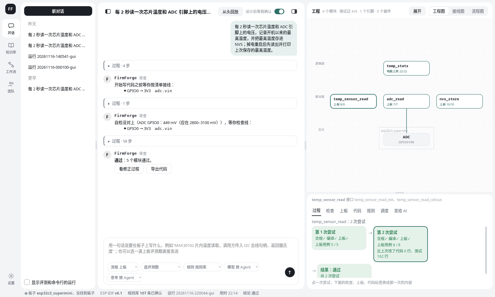

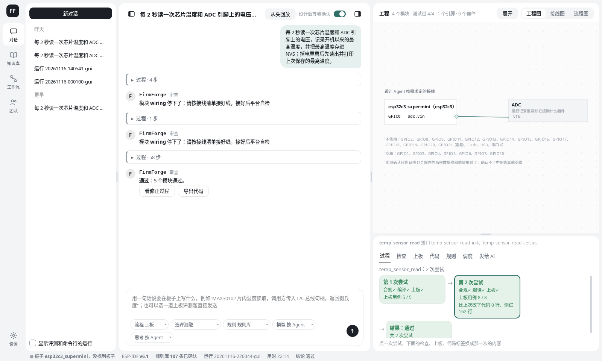

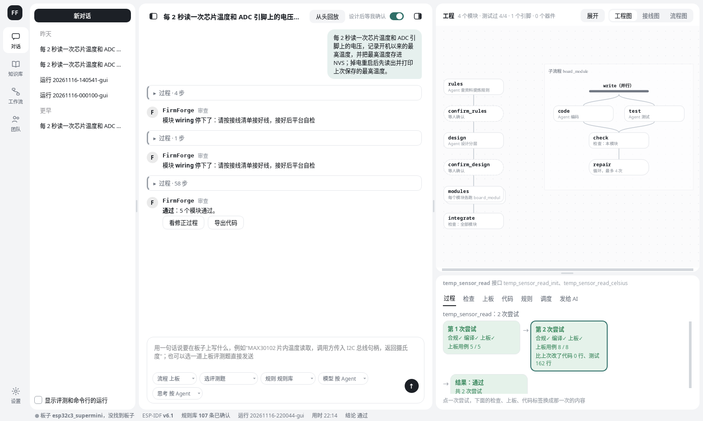

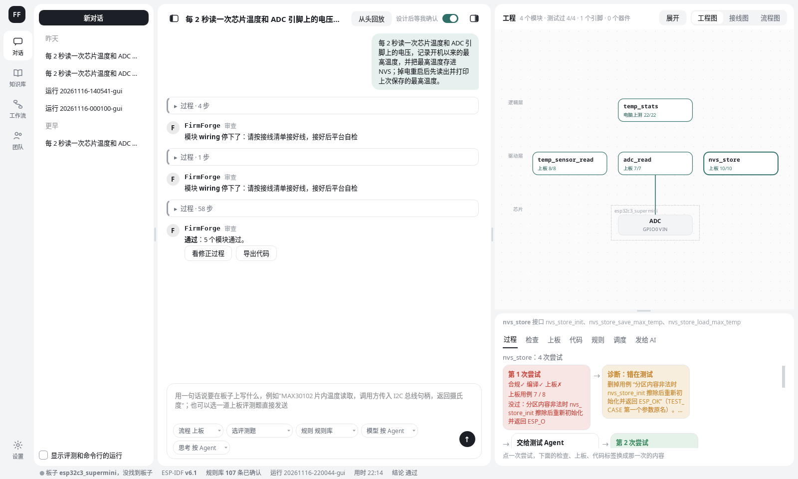

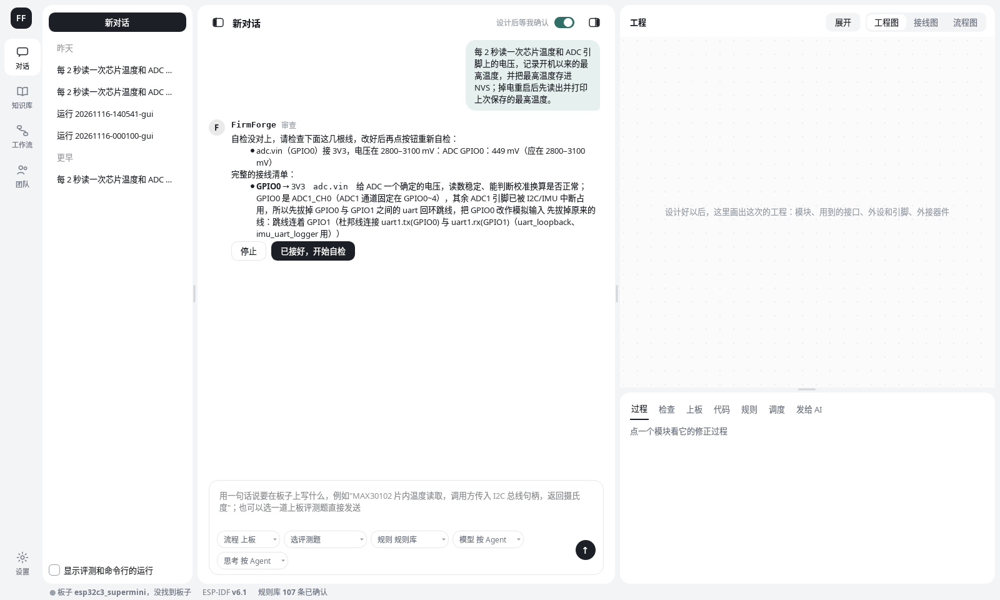

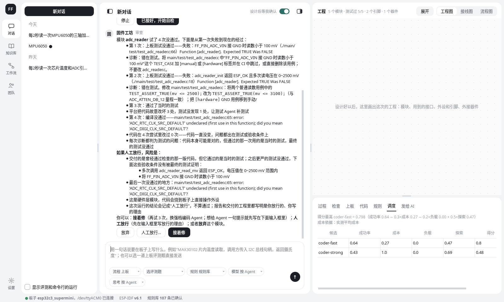

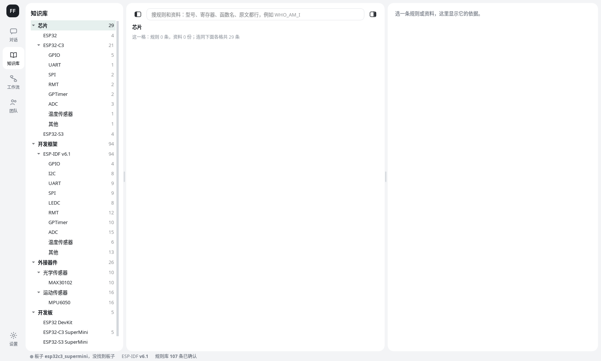

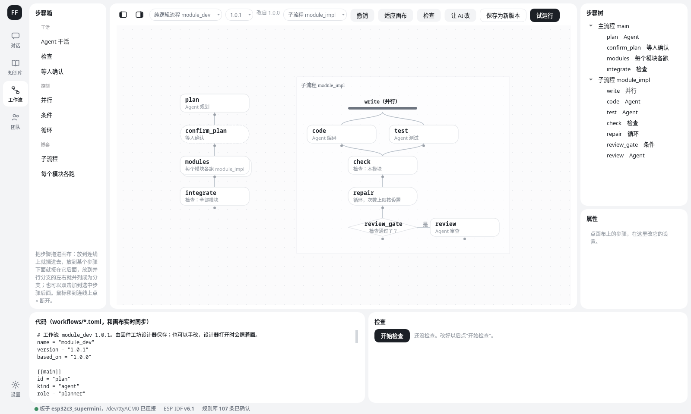

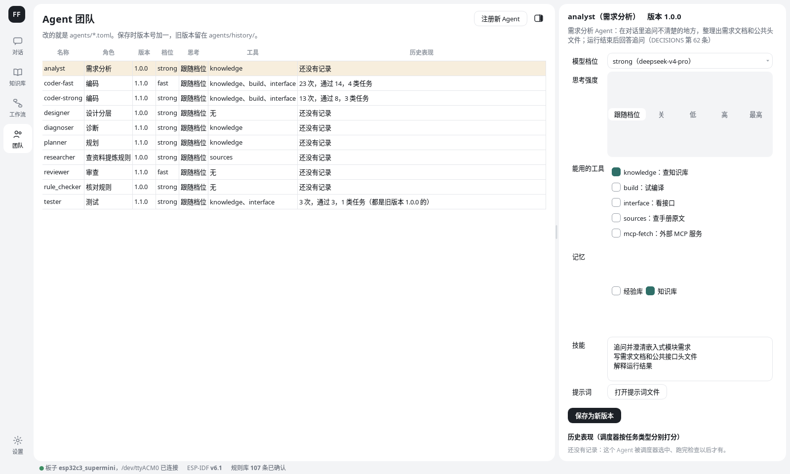

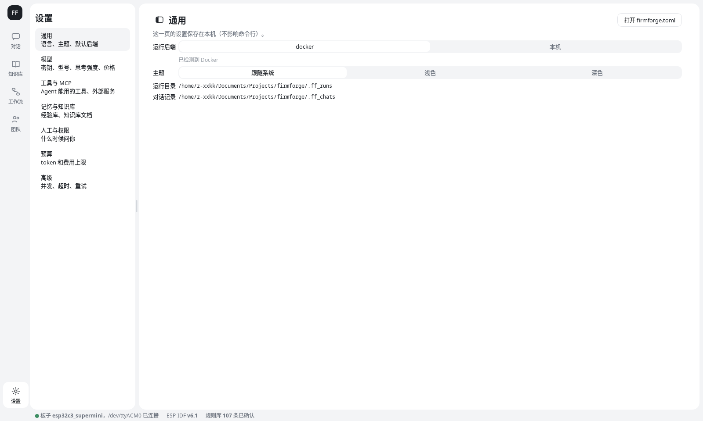

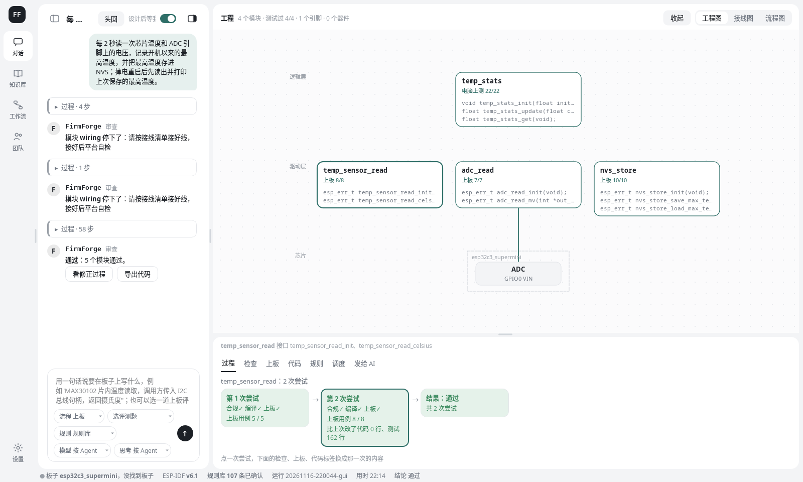

## 附录 B　复现方式

```bash
git clone https://github.com/z-xxkk/firmforge.git && cd firmforge
python3 -m venv .venv && .venv/bin/pip install -e ".[gui,sources]"
.venv/bin/python -m unittest discover -s tests          # 625 个单元测试，不联网、不花钱
.venv/bin/firmforge doctor                              # 检查工具链和板子
.venv/bin/firmforge check-board-tasks                   # 评测题自检（无板子时只编译）
.venv/bin/firmforge gui                                 # 桌面软件
```

完整的部署步骤、环境要求和没有开发板时能复现的内容见仓库 README；设计文档见 `docs/ARCHITECTURE.md`，全部设计决定见 `docs/DECISIONS.md`，测量方案与结果见 `docs/TEST_PLAN.md`。
